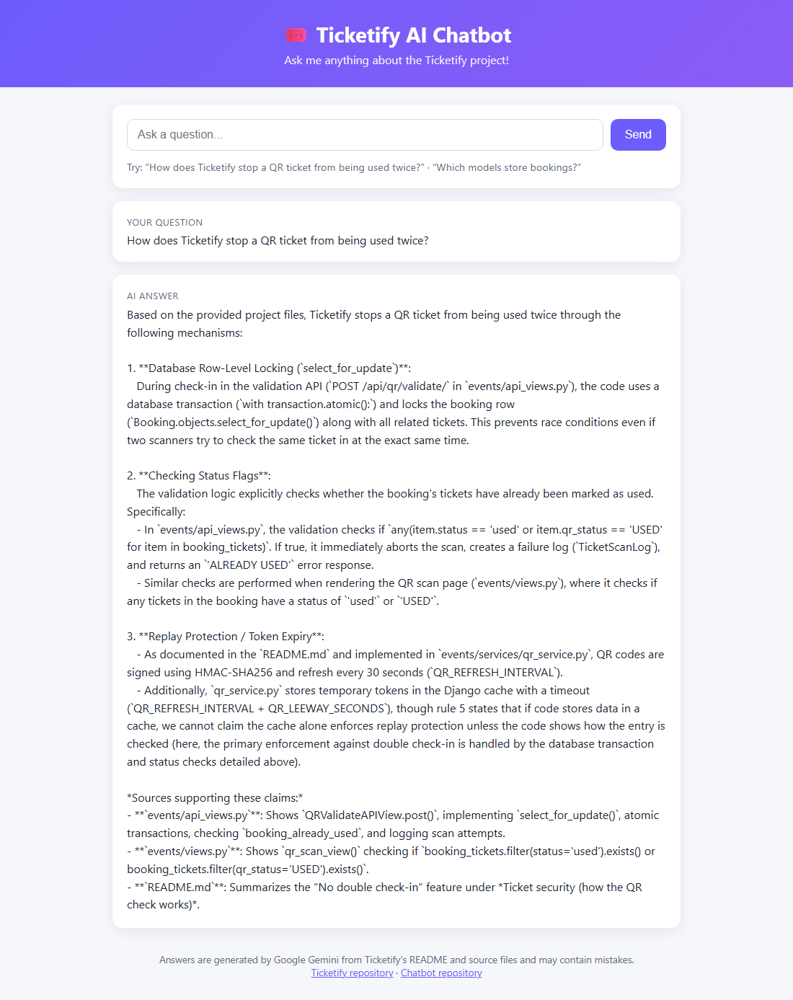
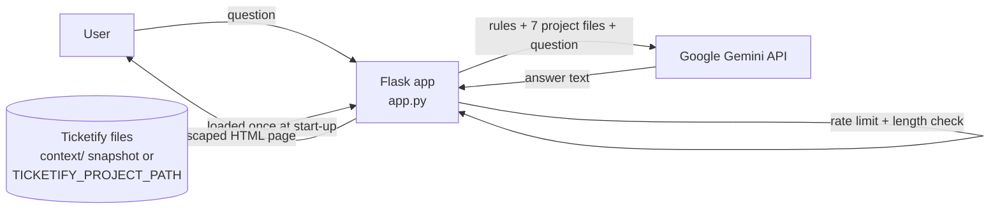
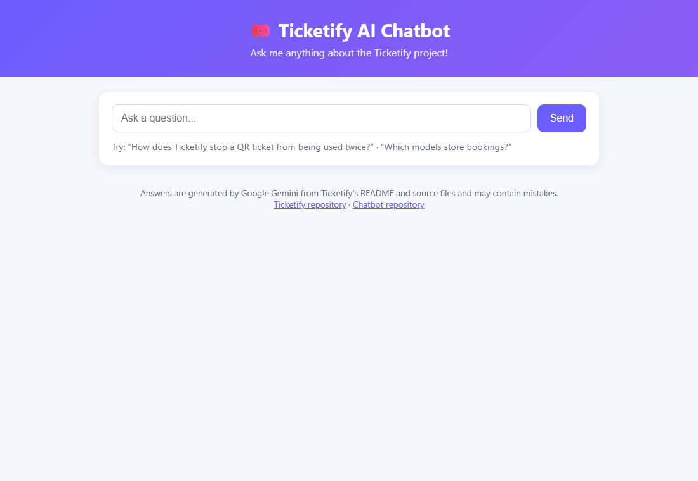

# 🤖 Ticketify AI Chatbot

A Generative AI assistant that answers questions about the **Ticketify** event-ticketing project. It sends Google Gemini the project's own README and source code, together with strict "do not invent anything" rules.


> **Main project:** [Ticketify](https://github.com/Aarthi23115/Ticketify-) is the Django event-booking platform this chatbot explains.



---

## Problem statement

A new developer, reviewer or recruiter who opens a codebase usually asks the same questions first. How does the QR check-in work? Where are bookings stored? Which endpoint validates a ticket?

Reading every file to find out takes time. A general-purpose chatbot can answer quickly, but it often makes up details about code it has never seen.

This chatbot answers in plain English **using only Ticketify's real files**. It is instructed to:
- name the file that supports each claim
- keep what the code *does* separate from what a comment *claims*
- say *"This information is not documented in the provided project files."* when the files don't contain the answer

## Features

- **Ask in plain English** through a simple web form.
- **Grounded answers:** each prompt includes 7 Ticketify files: the README, `models.py`, `views.py`, `api_views.py`, `urls.py`, `services/qr_service.py` and the QR scan template.
- **Prompt rules against hallucination:** use only the provided files, never invent code or behaviour, cite the supporting file, and don't trust comments over code.
- **Runs on its own:** a snapshot of Ticketify's files is bundled in `context/`. You can point the bot at a live Ticketify checkout instead with an environment variable.
- **Public-demo safeguards:**
  - a per-IP rate limit (10 questions a minute by default)
  - questions capped at 500 characters
  - the API key read only from the environment
  - HTML in questions and answers escaped
  - errors logged on the server and never shown to users
- **Health check:** a `/healthz` endpoint for hosting platforms.
- **Tests:** 9 unit tests, with Gemini mocked so they need no key.

## Tech stack

| Part | Technology |
|---|---|
| Language | Python 3.11+ |
| Web framework | Flask 3.1 |
| LLM | Google Gemini (`gemini-flash-lite-latest` by default) via the official `google-genai` SDK |
| Configuration | `python-dotenv` and environment variables |
| Production server | Gunicorn |
| Testing | `unittest` with `unittest.mock` |

The bot uses no database, no vector store and no embeddings. Its "knowledge" is the set of project files placed in the prompt (context stuffing).

## Architecture and workflow



1. **At start-up,** `app.py` decides where Ticketify's files are:
   1. the `TICKETIFY_PROJECT_PATH` environment variable, if set
   2. otherwise a sibling `../Ticketify` folder
   3. otherwise the bundled `context/` snapshot

   It then reads the 7 files into memory.
2. **On each question,** the app checks the rate limit and the length. It then builds one prompt from the accuracy rules, the 7 files and the question.
3. **Gemini** generates the answer, which is shown on the page (HTML-escaped).

## Folder structure

```
Ticketify-AI-Chatbot/
├── app.py              # Flask app: context loading, prompt, Gemini call, web page
├── sync_context.py     # refreshes context/ from a Ticketify checkout
├── test_app.py         # unit tests (Gemini mocked)
├── context/            # bundled snapshot of Ticketify's README and source files
├── docs/screenshots/
├── requirements.txt
├── render.yaml         # one-click Render deployment blueprint
├── .env.example        # environment variables (no real values)
└── .gitignore
```

## Installation

**Prerequisites:** Python 3.11+, and a Gemini API key, which is free from [Google AI Studio](https://aistudio.google.com/app/apikey).

```bash
git clone https://github.com/Aarthi23115/Ticketify-AI-Chatbot.git
cd Ticketify-AI-Chatbot
python -m venv .venv
```

Activate the virtual environment:

```bash
# Windows
.venv\Scripts\activate
# macOS / Linux
source .venv/bin/activate
```

```bash
pip install -r requirements.txt
```

## Environment setup

Copy `.env.example` to `.env` and add your key:

```
GEMINI_API_KEY=your-gemini-api-key
```

| Variable | Default | Purpose |
|---|---|---|
| `GEMINI_API_KEY` | – | **Required.** Your Gemini API key. |
| `GEMINI_MODEL` | `gemini-flash-lite-latest` | The Gemini model to use |
| `TICKETIFY_PROJECT_PATH` | – | Read live files from a Ticketify project folder instead of `context/` |
| `RATE_LIMIT_PER_MINUTE` | `10` | Questions allowed per IP per minute |
| `MAX_QUESTION_LENGTH` | `500` | Longer questions are cut off |
| `TRUST_PROXY` | `false` | Set to `true` behind a hosting proxy, so rate limiting sees the real client IP |
| `FLASK_DEBUG` | `false` | Debug mode, for local use only |

`.env` is in `.gitignore`. Never commit a real API key.

## How to run

```bash
python app.py
```

Then open <http://127.0.0.1:5000>.

Run the tests (no API key needed):

```bash
python -m unittest -v
```

To update the bundled snapshot after Ticketify changes, point the script at your Ticketify checkout:

```bash
python sync_context.py ../Ticketify-
```

## Deployment

The repo includes a [Render](https://render.com) blueprint, [`render.yaml`](render.yaml). It runs `gunicorn app:app` on Render's free web service and uses `/healthz` as its health check.

The API key is entered in the Render dashboard and is never stored in the repo.

Free-tier notes:
- **Cold starts:** the service sleeps when idle, so the first request can take a while.
- **Gemini quota:** each question uses your Gemini API quota. The rate limit protects it on a public demo.

## Screenshots

| Home | Answer grounded in project files |
|---|---|
|  |  |

Both screenshots come from the running app with a real Gemini response.

## Demo video

🎬 *Coming soon.* A 1-minute walkthrough will cover asking about QR security, bookings and an undocumented topic, to show the "not documented" behaviour.

## Live demo

🌐 *Deployment in progress* (planned on Render).

## Limitations and future improvements

- **Markdown shown as plain text:** answers appear as plain text, so Gemini's markdown (`**bold**`, lists) is shown as raw characters. Rendering markdown safely is a next step.
- **No memory:** each question is answered on its own, with no conversation history.
- **Whole files every time:** all 7 files are sent with every question. Retrieval (chunking + embeddings) would cut the tokens used and allow the whole repo to be covered.
- **Simple rate limit:** the limit lives in memory and is per process. Redis would be needed for multi-instance hosting.
- **Manual snapshot:** the `context/` snapshot must be refreshed by hand with `sync_context.py`.

## Author

**Aarthi Erra:** Python Developer / Generative AI Engineer (fresher)
[LinkedIn](https://www.linkedin.com/in/aarthi-erra-60142a338/) · [GitHub](https://github.com/Aarthi23115)
